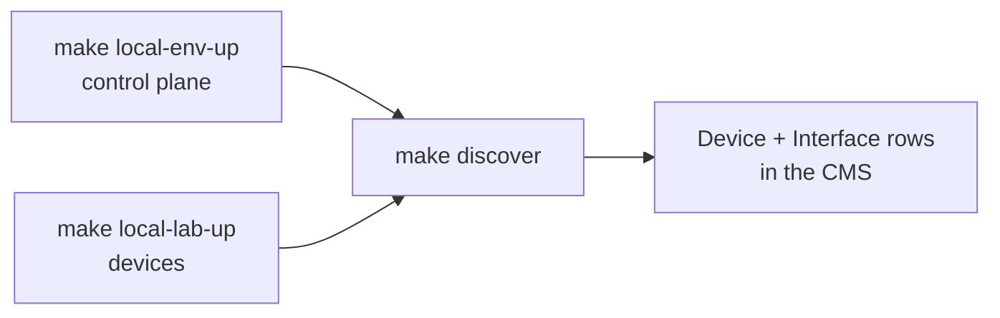

# Make targets

*The `Makefile` is the operator contract. Everything below exists in it today.*

## Three families

The targets split by **what they own**:

| Prefix | Owns | Runtime it drives |
|---|---|---|
| `local-env-*`, `worker-*` | the NeOps control plane — CMS, workflow engine, monitor app, web client, Postgres, Elasticsearch, Redis, `lab_bootstrap`, and the optional worker | `docker compose` only |
| `local-lab-*` | the containerlab devices | `./containerlab` only |
| `kind-lab-*` | the device pods in a KIND cluster | `kubectl` only |
| *(un-prefixed)* | operations that need **both** — `discover`, `kind-discover`, `apply-cms-config`, `kind-apply-cms-config`, `lab-grant` | whatever the operation needs |

A device target never touches the compose project: no `docker compose`, no CMS,
no engine, no token. `make local-lab-down` therefore leaves the control plane
running, and `make local-env-down` leaves the devices running. Bring them up in
either order.

`tests/test_target_families.py` pins that direction — it fails any
`local-lab-*` or `kind-lab-*` recipe that reaches for `docker compose`,
`apply_cms_config`, `lab_token`, `wait_ready` or an engine token, including
targets that do not exist yet. The other direction is convention only: nothing
stops a `local-env-*` target calling `./containerlab`, so keep it out by
hand.



## Scenarios

The lab holds more than one network. `SCENARIO` selects which one every target below acts on — see [Scenarios](../30-scenarios/index.md) for the mechanism.

| Target | What it does |
|---|---|
| `make scenarios` | Lists every scenario from its `scenario.json`: name, device count, supported flavours, title and summary. |
| `make scenario` | Prints the scenario the next target will act on, and says when it came from `.env`. |
| `make scenario-resolve` | Materialises `scenarios/_base` + `scenarios/$(SCENARIO)` into `generated/$(SCENARIO)/scenario/`, the one flat directory the containers mount and the scripts read. A prerequisite of `local-env-init`, `local-env-up`, `local-lab-up`, `discover`, `apply-cms-config`, `kind-lab-up`, `kind-discover` and `kind-apply-cms-config`, so you rarely call it directly. |
| `make generate` | `scenario-resolve`, then `./gen_clab_topology` — rebuilds the containerlab topology and the **committed** `scenarios/$(SCENARIO)/workflow-execution-parameters/*.json`. |

| Variable | Default | Purpose |
|---|---|---|
| `SCENARIO` | `wan-and-fabric` | Which lab to act on. The Makefile holds the **only** default and exports it |
| `SCENARIO_SRC` | `scenarios/$(SCENARIO)` | The scenario's source assets |
| `SCENARIO_DIR` | `generated/$(SCENARIO)/scenario` | The resolved overlay |
| `GEN_DIR` | `generated/$(SCENARIO)` | Where the generators write |

```bash
make scenarios                        # what is available
make scenario                         # what is selected right now
make local-lab-up SCENARIO=frr-only   # act on a different one
```

### Where `SCENARIO` comes from

Highest first:

1. the command line or the environment — `make local-lab-up SCENARIO=frr-only`
2. `.env` — for a checkout that always runs one lab
3. the Makefile's default, `wan-and-fabric`

make does not read `.env` on its own; docker compose does. So the Makefile reads
it **itself**, in the one place `SCENARIO` is resolved, and `export`s the
result — which then wins over `.env` for compose too. That is why the two can
never disagree. Write the line as `SCENARIO=name`, optionally prefixed with
`export`, unquoted and with no inline comment; those are the forms make and
compose both read, and `resolve_scenario` refuses anything else loudly.

```bash
# .env
SCENARIO=frr-only
```

!!! warning "Every other consumer fails on an unset `SCENARIO`"
    The four generators, `resolve_scenario`, `apply_cms_config` and
    `docker-compose.yml` read `SCENARIO` and refuse to run without it. A second
    default is how a scenario gets applied half from one lab and half from
    another — invisible until discovery produces a confusing result. Drive
    `docker compose` through `make`, or set `SCENARIO` yourself.

Only one scenario runs at a time: they share `lab-net`, the `172.30.0.0/24` subnet and the compose project. Switching is not a replacement — `containerlab destroy` acts on the nodes named in the topology it is handed, not on every container carrying the lab label, and `--reconfigure` destroys that same handed set, so deploying a smaller scenario over a larger one would strand the difference. `make local-lab-up` therefore **refuses** while `generated/.deployed-scenario-clab` records a different scenario; tear the running one down first.

## Environment lifecycle

The NeOps control plane. Never touches the devices.

| Target | What it does |
|---|---|
| `make local-env-init` | **One-time per environment.** Chains `lab-env`, `lab-jwt`, `lab-net` and `scenario-resolve`, then `touch`es `cms_api_key.env` so the engine's `env_file` exists before compose reads it (a `touch` never truncates, so on a re-init the file still holds the previous key — which is why the engine must not start yet). Pulls every image (`--policy always --ignore-pull-failures`), then brings up **only the CMS** and waits for it healthy: started now, the engine would boot on a key that is either the built-in `unsafe` placeholder or stale, refuse to start, and fail the whole `up` before a fresh key could be minted. Resolves the `neops` user's pk, mints a CMS API key and **overwrites** `cms_api_key.env` with it (fails on an empty key), runs `apply_cms_config`, force-recreates the engine so it loads the new token, mints an engine token, brings up the rest of the stack, and waits for `lab_bootstrap` to finish publishing the workflow definitions. |
| `make local-env-up` | Start the control plane again later. Refreshes the images, prints whether the worker profile is on, then `up -d --wait cms` → `apply_cms_config` → mint an engine token → `up -d` → wait for `lab_bootstrap` → and, **only when the worker profile is active**, `wait_ready` on the discovery function block. Fails with a clear message if `cms_api_key.env` is missing. |
| `make local-env-down` | `docker compose down` — stops the control plane, **keeps the volumes**. The devices keep running; `make local-lab-down` is their target. |
| `make local-env-prune` | `docker compose down -v` — **the true reset**. Drops the Elasticsearch and Postgres volumes, so all CMS data (discovered devices, interfaces, scopes) is destroyed and the key in `cms_api_key.env` becomes invalid for the new database. It does **not** delete that file, so always follow a prune with `make local-env-init`, not `local-env-up` — see the warning below. Leaves the devices and `lab-net` alone. |
| `make local-env-logs` | `docker compose logs -f` — every service compose has **enabled**, because which one failed is the question this target is reached for. Naming no service means the active profile set, so a worker started by `make worker-up` while `COMPOSE_PROFILES` is empty is missing from the output even though its container is running and carries the project's labels. `make worker-logs` names it, which enables its profile. |
| `make worker-up` / `worker-down` / `worker-logs` | Run the worker by hand. Naming it on the command line enables its profile, so these work with `COMPOSE_PROFILES` unset. `worker-up` chains `lab-net` and pulls the worker image first — with the profile off, that is the only place the moving `:develop` tag is ever refreshed. |

!!! warning "`local-env-prune` leaves `cms_api_key.env` on disk"
    The prune drops the database the key was minted against but not the file
    holding it, so a following `make local-env-up` boots the engine on a key the
    new CMS never issued and everything it does 401s. **Always `make
    local-env-init` after a prune** — it mints a fresh key. `apply_cms_config`
    probes the key before it applies anything and says exactly this rather than
    failing at its last step, after every role grant has already been written.

### The worker is optional

`COMPOSE_PROFILES` in `.env` decides whether `make local-env-up` starts the
worker. It is a docker compose variable, read natively — there is no make flag
for it.

```bash
COMPOSE_PROFILES=worker    # in .env: the worker comes up with the environment
# COMPOSE_PROFILES=        # the worker stays down; run one yourself
```

`lab_bootstrap` is **not** profiled: it publishes the workflow definitions and is
always part of the environment.

!!! warning "An `.env` created before this change has no `COMPOSE_PROFILES` line"
    `make lab-env` never overwrites an existing `.env`, so the worker silently
    stops coming up. Add the line yourself. `make local-env-up` prints
    `worker: enabled` or `worker: disabled` on every run so this is visible
    rather than mysterious.

!!! note "On a fresh clone the first run reports the opposite of what happens"
    `make lab-env` writes `.env` *during* the run, but make read `.env` at parse
    time — before it existed. So on that one invocation compose sees
    `COMPOSE_PROFILES=worker` and starts the worker while make still believes it
    is unset: the `worker: disabled` line is stale, and the `wait_ready` guard is
    skipped. `lab-env` says so when it creates the file. It self-corrects on the
    next invocation; nothing is left in a bad state.

The worker attaches to `lab-net` to reach the devices, so `make worker-up`
depends on `make lab-net`.

## Device lifecycle

containerlab only. Never touches the control plane — no `docker compose`, no
CMS, no engine, no token.

| Target | What it does |
|---|---|
| `make local-lab-up` | Chains `build-docker-frr`, `lab-net` and `scenario-resolve`. Refuses to run if a *different* scenario is recorded in `generated/.deployed-scenario-clab`, then generates the topology, runs `./containerlab deploy --reconfigure` (re-runnable; SR Linux boots slowly), waits for every device to accept SSH, and writes the marker. One image built, nothing pulled. |
| `make local-lab-down` | `./containerlab destroy --cleanup --keep-mgmt-net` on the scenario the **marker** names — not necessarily `$(SCENARIO)` — then removes the marker. `--keep-mgmt-net` because `lab-net` is not containerlab's to remove. The control plane keeps running. |
| `make local-lab-status` | `./containerlab inspect` against the deployed scenario's topology. |
| `make kind-lab-up` / `kind-lab-down` / `kind-lab-status` | The same three for the Kubernetes flavour — see [the Kubernetes lab](50-kubernetes-lab.md). |

!!! note "A failed teardown keeps the marker"
    The marker is the only record of what is deployed, so `local-lab-down`
    removes it **only once the destroy has succeeded**, and a failed destroy
    fails the target. That is what stops `make local-lab-up SCENARIO=other` from
    getting past its guard and leaving two scenarios running side by side — and
    it is why the reset one-liner is `make local-lab-down local-env-prune`: make
    stops before the prune if the devices did not go down. Nothing to destroy is
    not a failure.

!!! note "Tearing the devices down leaves the worker up"
    That is the intended end state, but it has a confusing signature: `wait_ready`
    still reports the discovery function block registered — the worker is
    healthy and attached to `lab-net` — while `make discover` fails against
    devices that are no longer there.

## Operations

Things that act across both families: they need the engine *and* the devices.

| Target | What it does |
|---|---|
| `make discover` | Runs `apply_cms_config`, mints one engine token, waits for the discovery function block and for device SSH, then POSTs a workflow execution and polls to a terminal state (15-minute ceiling). Override `DISCOVER_PARAMS` to change targeting. |
| `make kind-discover` | The same against the KIND pods, publishing the definition first because no `lab_bootstrap` ran. |
| `make apply-cms-config` | Runs `./apply_cms_config` on its own — see [below](#what-apply_cms_config-does). Idempotent, and worth re-running after a CMS restart. |
| `make kind-apply-cms-config` | The same against a Kubernetes-deployed CMS, through `CMS_EXEC`. |
| `make lab-grant` | `make lab-grant ROLE=<role> [PROFILE=operator]` — one ad-hoc workflow grant, the same `manage.py grant_workflow_permissions` call `apply_cms_config` makes per role. Grants only widen — see [Authorization](../10-concepts/50-authorization.md). |

```bash
make discover \
  DISCOVER_PARAMS=scenarios/wan-and-fabric/workflow-execution-parameters/discover-params-autodetect.json
```

## Variables

| Variable | Default | Purpose |
|---|---|---|
| `DISCOVER_PARAMS` | `$(SCENARIO_SRC)/workflow-execution-parameters/discover-params.json` | Which parameter file `discover` sends |
| `PROFILE` | `operator` | Grant profile `lab-grant` applies: `author`, `operator` or `admin` |
| `NEOPS_ENGINE_TOKEN` (env) | *(minted per target)* | Engine access token; export one to reuse it across targets |
| `DISCOVER_FB` | `fb.base.neops.io/global_discover_network:0.1.0` | The function block `wait_ready` blocks on. Shared with the Kubernetes flavour |
| `DISCOVER_WORKFLOW` | `wf.lab.neops.io/simple_lab_discovery:1.2.0` | The definition that is executed; must match the version in the workflow YAML. Shared with the Kubernetes flavour |
| `CLAB_TOPO` | `$(GEN_DIR)/clab/neops-lab.clab.json` | The generated containerlab topology |
| `CONTAINERLAB` | `./containerlab` | The containerlab launcher |
| `CLAB_IMAGE` (env) | `ghcr.io/srl-labs/clab:0.78.2` | containerlab version the launcher runs |
| `LAB_NET_NAME` | `lab-net` | The device management network. Created by `containerlab deploy` from the topology's `mgmt` block, or by `make lab-net`; **external** to docker compose |
| `PROBE_IMAGE` | `python:3.12-slim` | Image the throwaway `wait_devices` container runs in |
| `COMPOSE_PROFILES` | *(from `.env`)* | Which optional compose services run; `worker` is the only profile the lab defines |
| `WAIT_READY_TIMEOUT` | `180` | Seconds `wait_ready` waits for an online worker |
| `WAIT_DEVICES_TIMEOUT` | `240` | Seconds `wait_devices` waits for device SSH |

These are make/environment variables (`make local-lab-up WAIT_DEVICES_TIMEOUT=600`).
Two of them also live in `.env`, and the Makefile reads that file itself for
both — `SCENARIO`, which it then `export`s so its value wins for compose too,
and `COMPOSE_PROFILES`, which it only *reads* (compose resolves that one
natively, and a value make misread must not be able to turn off a worker compose
would have started).


## Kubernetes lab lifecycle

A separate flavour that runs the FRR devices as pods in a local KIND cluster. It needs neither containerlab nor the compose stack — see [Kubernetes lab](50-kubernetes-lab.md) for the full picture.

| Target | What it does |
|---|---|
| `make kind-lab-up` | Depends on `build-docker-frr` and `scenario-resolve`. `kind load`s the image onto the cluster nodes, generates `generated/$(SCENARIO)/kind/lab.yaml` from the scenario's `topology.json`, applies it, waits for every Deployment to become Available, then prints each device's in-cluster DNS name. Renders `vendor: "frr"` devices only, so the scenario must declare the `kind` flavour. |
| `make kind-lab-status` | `kubectl get pods,svc` in the lab namespace. |
| `make kind-lab-down` | Deletes the namespace. The cluster itself is never touched. |
| `make kind-apply-cms-config` | Runs `apply_cms_config` against a Kubernetes-deployed CMS: grants the `neops` user the `lab-admin` role and seeds the `Global` scope, without which the web client shows no scope at all. Idempotent. |
| `make kind-discover` | Publishes the workflow definition with `bootstrap/register.py`, generates the per-device targets with `./gen_kind_discover_params`, waits for the discovery function block with `./wait_ready`, then executes it with `./run_workflow`. Depends on `build-docker-bootstrap`, and on the engine being reachable at `KIND_ENGINE_URL`. |

`kind-apply-cms-config` opens a short-lived `kubectl port-forward` to the CMS and reads the API key from a cluster Secret; it touches nothing else in the product namespace. Getting the *devices* into the CMS is discovery's job, and `kind-discover` does it by driving the same workflow, the same function block and the same four scripts the containerlab flavour uses — it needs a worker image that actually carries the base function blocks. See [Kubernetes lab](50-kubernetes-lab.md).

| Variable | Default | Purpose |
|---|---|---|
| `KIND_CLUSTER` | `kind` | Cluster the image is loaded into |
| `KIND_LAB_NAMESPACE` | `neops-lab` | Namespace the devices live in |
| `KIND_LAB_TIMEOUT` | `180` | Seconds `kubectl wait` allows for the pods |
| `KIND_MANIFEST` | `$(GEN_DIR)/kind/lab.yaml` | The generated manifest |
| `KIND_ENGINE_URL` | `http://engine.neops.local` | How the host and the bootstrap container reach the workflow engine. The offline ingress name, so run `make -C neops-helm config-hosts` once |
| `KIND_DISCOVER_PARAMS` | `$(GEN_DIR)/kind/discover-params.json` | The generated discovery parameters |
| `KIND_DISCOVER_TIMEOUT` | `600` | Seconds `run_workflow` polls for a terminal state |
| `NEOPS_NAMESPACE` | `neops` | Namespace the product stack runs in |
| `NEOPS_CMS_DEPLOYMENT` | `neops-neops-core` | Deployment `apply_cms_config` runs `manage.py` in |
| `NEOPS_CMS_SERVICE` / `NEOPS_CMS_PORT` | `neops-neops-core` / `8000` | What the port-forward targets |
| `NEOPS_CMS_TOKEN_SECRET` | `neops-neops-workflow-engine` | Secret the CMS API key is read from |
| `CMS_PORT` | `18000` | Local end of the port-forward |
| `CMS_EXEC` | the `kubectl exec` form | How `apply_cms_config` runs `manage.py`; the script's own default is the compose lab |

## Host setup

Run once per machine or per clone; everything here is idempotent.

| Target | What it does |
|---|---|
| `make doctor` | Host preflight (`./doctor`): docker + RAM, amd64 emulation on Apple Silicon, mount round-trip, subnet overlaps, the clab image, python3. Read-only apart from pulling two images; the fix is printed per failure. |
| `make lab-jwt` | Mints `cms/jwt/{private,public}.pem` with `openssl genpkey` if absent. A prerequisite of `local-env-init` and `local-env-up`. |
| `make lab-env` | Copies `.env.example` to `.env` if there is no `.env` yet, so a fresh clone has one to edit. **Never overwrites an existing file** — which is the migration hazard behind `COMPOSE_PROFILES`. A prerequisite of `local-env-init` and `local-env-up`. |
| `make lab-net` | Creates the `lab-net` bridge with the subnet from `gen_clab_topology.LAB_SUBNET`, if it does not exist. It is `external` to docker compose, which aborts on a missing external network rather than creating one — so on a fresh clone this is what brings it into being before any device is deployed. A prerequisite of `local-env-init`, `local-env-up`, `local-lab-up` and `worker-up`. |
| `make clab-suid` | For the `CLAB_NATIVE` (host binary) path: sets the SUID bit on the `containerlab` binary so the device targets can deploy without `sudo`. It only prompts for a password when the bit is missing, and warns if you are not in `clab_admins`. Re-run after every containerlab upgrade. Deliberately **not** chained into `local-lab-up`, which must never prompt mid-run. See [Prerequisites](../getting-started/10-prerequisites.md#native-binary-optional). |

## What `apply_cms_config` does

!!! warning "Re-run `apply-cms-config` after a CMS restart"
    The CMS image seeds a scope named `Global` on every startup with
    `always_update_on_restart=True`, so a restart resets its columns and
    filters to the image defaults. `dashboard_configuration` is *not* reset —
    `init_scopes` never writes it. Re-run `make apply-cms-config` to reapply
    the lab's columns and drill-down.

It grants the `neops` user a full-permission role (`lab-admin`, `default_permission=7`) and applies the scenario's `cms/permissions.json` — every declared role gets `default_permission=7` and a `RoleScope` on `Global`, every declared user gets its roles and a password equal to its username, and each role's workflow grant profile is applied through the CMS's own `manage.py grant_workflow_permissions`. See [Authorization](../10-concepts/50-authorization.md).

It also configures the `Global` scope from the JSON files under `generated/$(SCENARIO)/scenario/scope/Global/` — table columns for devices, interfaces, clients and groups, a location drill-down schema, and a dashboard configuration. Those files, and `cms/permissions.json`, come from `scenarios/_base/` unless the scenario overrides one; edit them there, not in `generated/`.

It is **bash, not Python**, and it uses `manage.py shell` rather than GraphQL for the seeding steps: `roleUpsert` / `scopesUpsert` / `roleScopeUpsert` all gate on permissions the freshly-bootstrapped `neops` user does not yet have. Table columns and drill-down *are* written through GraphQL, deliberately **last**, because the CMS's `init_scopes` runs on every `manage.py` invocation and would otherwise overwrite a shell write.

If you reorder anything in that script, read its header comment first.

## Images

| Target | What it does |
|---|---|
| `make build-docker` | Builds both local-only images — `neops-lab-frr:latest` and `neops-lab-bootstrap:latest`. Nothing is pushed. |
| `make build-docker-frr` | Just `neops-lab-frr:latest` from `devices/frr/`. A **device** image: a prerequisite of `local-lab-up` and `kind-lab-up`, neither of which needs the bootstrap image. |
| `make build-docker-bootstrap` | Just `neops-lab-bootstrap:latest` from `bootstrap/`. An **environment** image: `docker-compose.yml` builds it for the `lab_bootstrap` service, and `kind-discover` depends on it. |

`DOCKER_BUILD_FLAGS` is passed to every `docker build`; set it to `--network=host` on a host whose docker bridge cannot resolve DNS. See [Images](20-images.md).

## Quality gates

| Target | What it runs |
|---|---|
| `make lint` | `ruff format --check .` then `ruff check .` |
| `make format` | `ruff format .` then `ruff check --fix .` |
| `make typeCheck` | `pyrefly check` |
| `make test` | `pytest tests` — the generator unit tests (parametrised over every scenario), the scenario-manifest checks, and the repo invariants (subnets, the one-`SCENARIO`-default rule) |
| `make py39-check` | Imports the host scripts under Python 3.9 (the stock macOS python3) |
| `make shell-syntax` | `bash -n` over `apply_cms_config`, `containerlab`, `doctor` |
| `make check` | `lint typeCheck test py39-check shell-syntax` — the one to run before pushing |

## Documentation

Contributed by the vendored `mkdocs-documentation` tooling in `.make_scripts/mkdocs-documentation/`:

| Target | What it does |
|---|---|
| `make doc-serve` | Live-preview server; regenerates `mkdocs.yml` when `mkdocs_custom.yml` or `mkdocs_base.yml` change |
| `make doc-build` | Regenerate `mkdocs.yml`, `mkdocs build`, then clean the site dir |
| `make doc-build-docker` / `make doc-run-docker` | Build and run the docs as an NGINX image |
| `make doc-create-mkdocs` | Regenerate `mkdocs.yml` and refresh the docs CI workflow |
| `make doc-update-assets` | Pull the latest tooling release into `.make_scripts/` |

!!! danger "`mkdocs.yml` is autogenerated — never edit it"
    It is produced by `setup_documentation.py` from this repo's
    `mkdocs_custom.yml` deep-merged over the shared `mkdocs_base.yml`. Edit
    `mkdocs_custom.yml`. Note that **dicts merge but lists concatenate**, so
    re-declaring `hooks:` or `plugins:` entries that the base already has
    registers them twice.

## Release and infrastructure

Contributed by the vendored `release-management` and `project-infrastructure` tooling:

| Target | What it does |
|---|---|
| `make tag-patch` / `tag-minor` / `tag-major` (+ `-beta`) | Create a local annotated SemVer tag |
| `make tag-latest-beta`, `make check-for-releases`, `make hard-reset-tags`, `make tag-major-minor-ruleset` | Tag helpers |
| `make sync-release-assets`, `make sync-infrastructure-assets` | Re-vendor the tooling scripts (destructive by design — they `rm -rf` the vendored dir first) |
| `make github-set-branch-protections`, `make github-set-default-branch`, `make github-autodelete-merged-branches` | Repository settings |

!!! note "Tagging this repo publishes nothing"
    `neops-lab` is not a distributable package — no wheel, no npm package, no
    registry image. `make tag-*` creates a **local** annotated tag; the
    separate `git push --tags` is what triggers downstream pipelines in repos
    that have them. This one has none.

## Full reset

```bash
make local-lab-down local-env-prune
make local-env-init && make local-lab-up && make discover
```

`local-env-init` and not `local-env-up`: the prune invalidates the key in
`cms_api_key.env` and only `init` mints a new one. The first line stops before
the prune if the devices did not go down — a failed `local-lab-down` fails,
deliberately, so the deployed-scenario marker survives.
