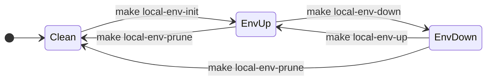
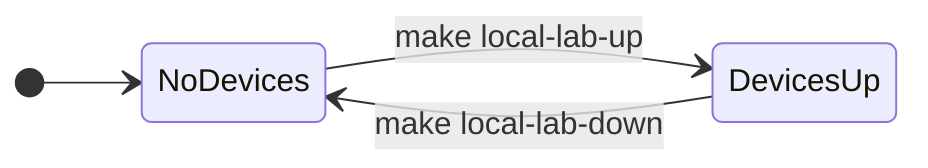

# Operating the lab

*Everything you need after the first successful run.*

## In this section

-   :material-console-line:{ .lg .middle } &nbsp; **[Make targets](10-make-targets.md)**

    ---

    The complete list — lab lifecycle, environment lifecycle, quality gates, and the targets the two vendored tooling repos contribute. What each one does and when to reach for it.

-   :material-docker:{ .lg .middle } &nbsp; **[Images](20-images.md)**

    ---

    The two local-only images this repo builds (`neops-lab-frr`, `neops-lab-bootstrap`), the four published images it consumes, and how to swap any of them for a local build.

-   :material-plus-network:{ .lg .middle } &nbsp; **[Adding a device](30-adding-a-device.md)**

    ---

    The four-step loop: edit the scenario's `topology.json`, regenerate, redeploy, commit the regenerated parameter files — because the generator tests will fail until you do.

-   :material-lifebuoy:{ .lg .middle } &nbsp; **[Troubleshooting](40-troubleshooting.md)**

    ---

    Indexed by symptom. Most failures here are one of three boot-order races, each with a distinctive error string and a wait that already exists to prevent it.

-   :material-kubernetes:{ .lg .middle } &nbsp; **[Kubernetes lab](50-kubernetes-lab.md)**

    ---

    The FRR devices as pods in a local KIND cluster, reached by in-cluster DNS. A second flavour of the lab that needs neither containerlab nor the control plane.

## The lifecycle at a glance

The environment and the devices are independent — the arrows below cross only at `make discover`, and either half can be torn down without the other.

The control plane:

The devices, independently:

`make discover` needs `EnvUp` **and** `DevicesUp`, and is what writes the `Device` and `Interface` rows into the CMS. It is re-runnable; nothing else joins the two halves.

`local-lab-down` destroys the devices and touches nothing else — the control plane keeps running, `lab-net` survives (`--keep-mgmt-net`), and the worker stays attached to it. `local-env-down` stops the control plane but **keeps** the Elasticsearch and Postgres volumes, so the CMS data survives. `local-env-prune` is the real reset — and because it leaves `cms_api_key.env` on disk, the next bring-up must be `local-env-init`, not `local-env-up`.

!!! note "Devices down, worker up"
    After `make local-lab-down` the worker is still healthy and still registered
    with the engine, so `wait_ready` passes — but `make discover` fails against
    devices that are no longer there. That is the intended end state, not a
    broken one.

Every target above acts on one scenario, selected with `SCENARIO` and defaulting to `wan-and-fabric`. One scenario runs at a time — see [Scenarios](../30-scenarios/index.md).
